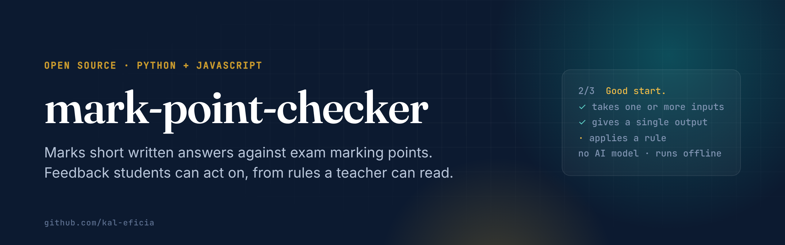
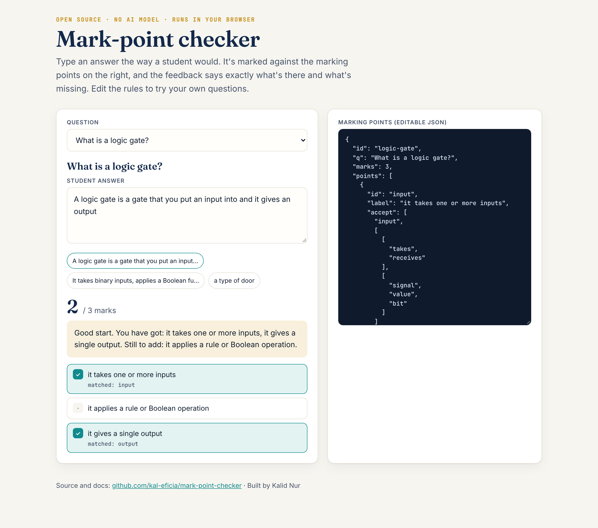

<p align="center"></p>

<p align="center">
  <a href="https://kal-eficia.github.io/mark-point-checker/"></a>
  
  
  
</p>

"A logic gate is a gate that you put an input into and it gives an output." Two marks out of three. The student needs to know which mark they got, and which one they're missing, while they still care.

**mark-point-checker** marks short written answers against exam-style marking points and gives feedback a student can act on straight away:

> Good start. You have got: it takes one or more inputs, it gives a single output. Still to add: it applies a rule or Boolean operation.

**[Try it in your browser →](https://kal-eficia.github.io/mark-point-checker/)**

<p align="center"></p>

## Why rules and not an AI model

- **A teacher can read every rule.** If a mark is given, the evidence is shown. If it isn't, you can see which phrasing was missing and add it.
- **Same answer, same mark, every time.** No drift, no prompt to tune, nothing to pay per answer.
- **It runs anywhere.** Python on a server, or the JavaScript twin in a student's browser, with no data leaving the page.

It handles what students actually write: plurals and tenses (*inputs*, *unplugged*), one-letter slips (*imputs*, *assending*), negation (*"it does **not** lose data"* gets no mark), and clause breaks (*"not descending, ascending"* still gets the ascending mark).

## Marking points

```json
{
  "id": "ram-volatile",
  "q": "Explain why RAM is described as volatile.",
  "marks": 2,
  "points": [
    { "id": "lost",  "label": "its contents are lost",
      "accept": ["lost", "loses", "erased", "wiped", "cleared"],
      "forbid": ["permanent", "keeps its data"] },
    { "id": "power", "label": "when the power is switched off",
      "accept": ["power", "unplugged", "electricity",
                 [["switch", "turn", "shut"], "off"]] }
  ]
}
```

- `accept`: a phrase, or a list of parts that must all appear, where each part can list alternatives.
- `forbid`: a phrase that blocks the mark and adds a "check this" note (catches *descending* for *ascending*).
- `label`: what the student reads in the feedback, so write it to the student.
- `minWords` (optional): nudges very short answers.

## Use it

```bash
pip install git+https://github.com/kal-eficia/mark-point-checker

markpoint check examples/questions.json logic-gate "It takes inputs and gives an output"
markpoint batch examples/questions.json answers.csv -o marked.csv     # student,question_id,answer
markpoint try   examples/questions.json                               # type answers, see feedback
```

```python
from markpoint import mark
r = mark("Because the data is lost when the power is turned off", question)
r.score, r.max_marks, r.feedback()   # (2, 2, 'Full marks.')
```

In the browser:

```html
<script src="markpoint.js"></script>
<script>
  const r = MarkPoint.mark(answer, question);
  r.score; r.feedback; r.got; r.missing;
</script>
```

## Tested both ways

`tests/cases.json` holds real-style student answers with the marks a teacher would give. The test suite runs every case through the Python marker **and** the JavaScript twin and checks they agree on the score, the points and the exact feedback.

```bash
python -m unittest discover -s tests
```

## Related

- [ai-teaching-skills](https://github.com/kal-eficia/ai-teaching-skills): the `exam-question-writer` skill writes mark schemes in this format
- [lesson-page-kit](https://github.com/kal-eficia/lesson-page-kit): student lesson pages that can use this for written answers
- [excelia-live](https://github.com/kal-eficia/excelia-live): the live class dashboard this checker came out of

---

Built by [Kalid Nur](https://github.com/kal-eficia) for his own Computer Science and ICT classes. MIT licence.
